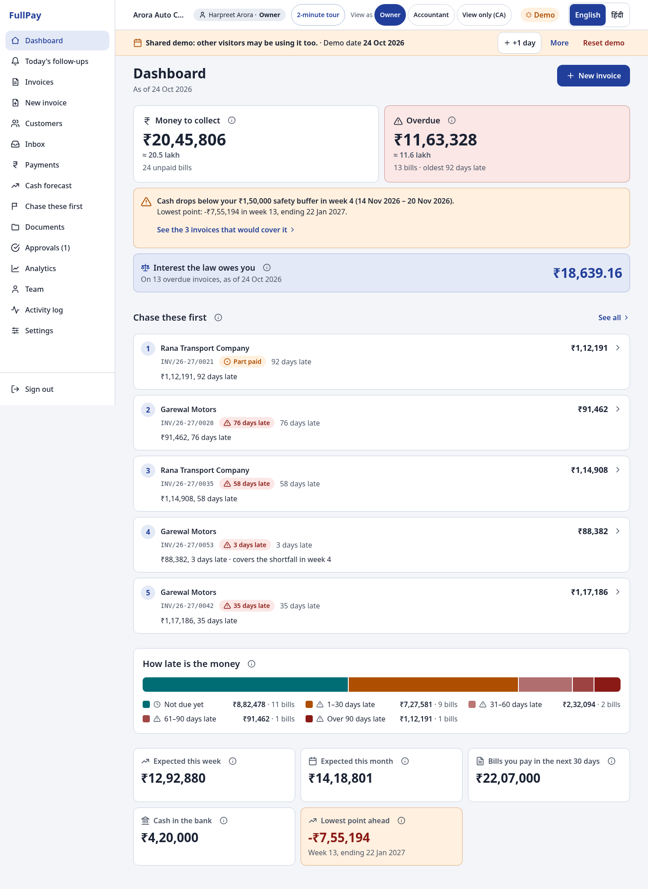
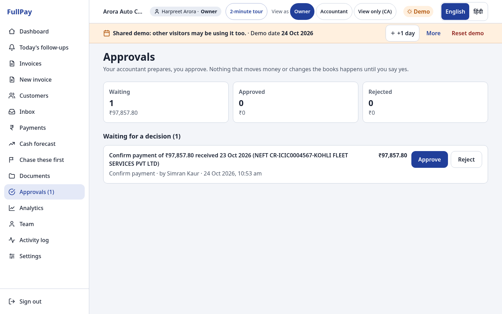
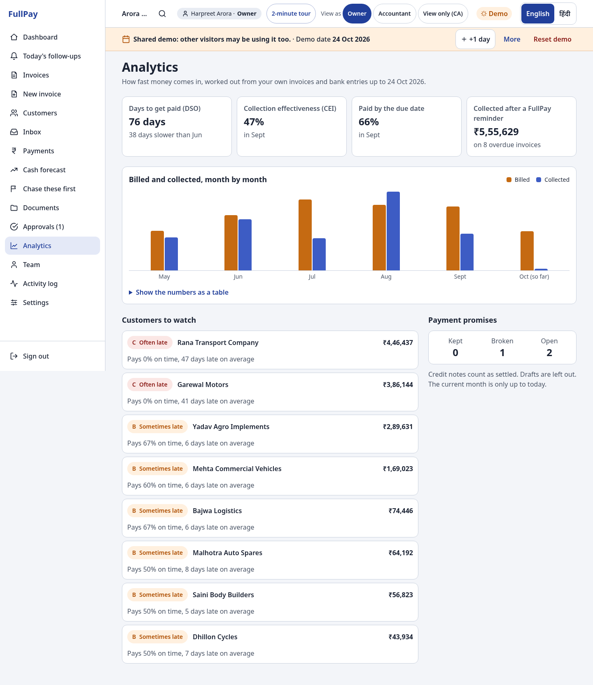
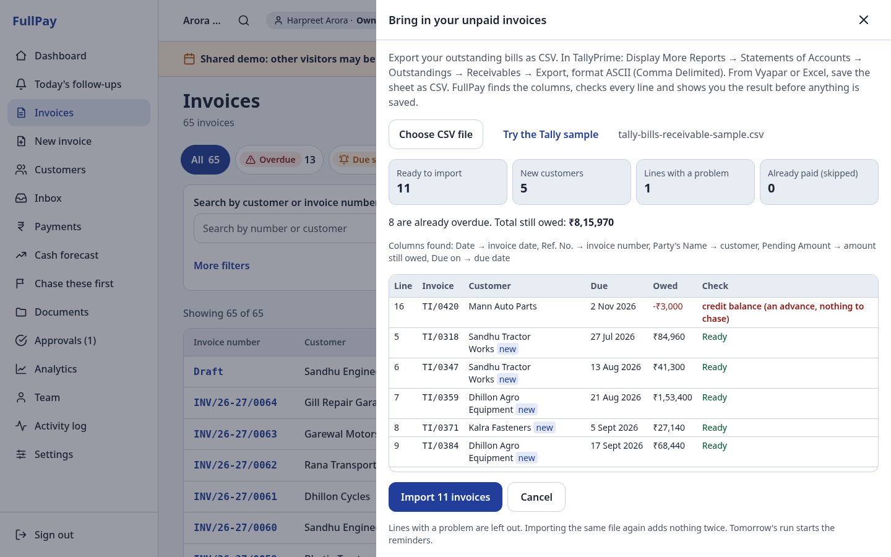
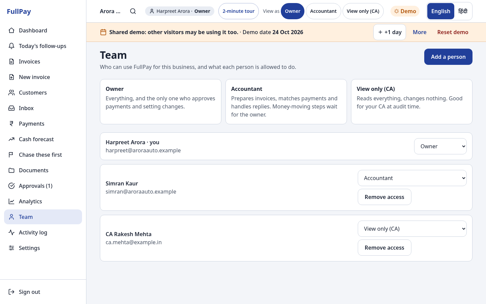

# FullPay — get paid in full, with the interest the law owes you

**HackCache '26 · Problem statement 4: The Small Business Invoice Chase · Team FullPay**

FullPay helps an Indian micro or small business track unpaid invoices, follow up on time and politely (English or Hindi), issue GST-compliant tax invoices and Payment Demand Letters, match bank payments, see a cash shortage weeks ahead — and, when a buyer still will not pay, prepare a tamper-evident evidence pack for the MSME ODR portal with period-correct MSMED Act §16 interest.

> Every "-Pay" app helps you pay. FullPay is for getting paid — in full.

**Live demo:** https://fullpay-web.onrender.com · **Status of the automatic run:** `/status`

---

## For judges: the 2-minute tour

The demo is shared by everyone who opens it. If someone has moved the demo clock, use **Reset demo** in the banner.
Prefer to be guided? Press **2-minute tour** in the header: ten steps over the real screens.

| Clock | Do | What you see |
|---|---|---|
| 0:00 | Open the live link → **Open the live demo** (no password) | Dashboard: money to collect, overdue, the week cash drops below the safety buffer, **interest the law owes you (MSMED Act §16)**, ageing bar, top 5 to chase with reasons |
| 0:15 | **Invoices → INV/26-27/0042 → Payment Demand Letter** | Title "Payment Demand Letter", the "not a GST notice, not a legal notice" line, interest period by period with the RBI source of every rate, GST on the interest "payable when received" |
| 0:40 | Scan the letter's QR with a phone, or open `/v/49bf667d23b55105` | **Record unaltered**, and "pay only to" the UPI ID and bank account recorded when the invoice was issued |
| 0:55 | **Payments → Load sample statement** | All six cases from the brief matched with a confidence and a reason, including the payment short by exactly 2% flagged as possible TDS. Nothing is marked paid until you confirm |
| 1:15 | **Cash forecast** → switch a what-if on | 13 weeks, the first short week, and the invoices that would cover the gap |
| 1:30 | **Today's follow-ups** | Each reminder ready in the customer's language, one tap to WhatsApp, email or SMS |
| 1:45 | Open the customer link `/pay/whoZYlu9YOc2d-scWQ-yx1mX1ukgynkn` → **Something's wrong** | The dispute pauses the reminders and lands in the owner's Inbox |
| 1:55 | Switch to **हिंदी** in the header | Every screen, message and printed heading switches |
| +0:20 | **View as → Accountant**, confirm any payment; **View as → Owner** → **Approvals** | Maker-checker: the accountant's confirmation waits; the owner approves; the record names who prepared and who approved |
| +0:20 | **Invoices → Import from Tally / Vyapar / Excel → Try the Tally sample** | Every line checked before saving: 11 ready, 5 new customers, 1 credit balance left out |
| +0:15 | **Analytics** | Days to get paid (DSO), collection effectiveness, paid by the due date, money collected after a FullPay reminder |



More screens: [docs/screenshots](docs/screenshots/index.html) (regenerate with `node scripts/screens.js`).

---

## What is real and what is simulated

- **Real:** GST maths, invoice numbering, GSTIN check digits, §16 interest, the reminder ladder, the daily automatic run, bank-statement matching, the 13-week forecast, the hash-chained record and its public check page, the English and Hindi interface.
- **Simulated:** the business (Arora Auto Components, Ludhiana), its customers, GSTINs, phone numbers and bank details are made up. The UPI payment on the pay page moves no money; it creates a payment that goes through the same matcher as a real bank line. WhatsApp and SMS open the owner's own app with the message filled in; automatic sending is email only.

## Documents for judges

| | |
|---|---|
| [`/proof`](https://fullpay-web.onrender.com/proof) | The organiser pack's "before you finish" checks, run live: expected, actual, pass |
| [docs/pack-conformance.md](docs/pack-conformance.md) | Every pack requirement, its status, and where to check it |
| [docs/acceptance.md](docs/acceptance.md) | Every screen in English and Hindi at 360 px (normal and largest text) and 1280 px: 162 of 162 pass |
| [docs/scale.md](docs/scale.md) | 20,065 invoices, 54,526 payments: what we measured, what broke, what we fixed |
| [docs/demo-script.md](docs/demo-script.md) | The 3-minute demo, and what could go wrong live |
| [docs/deploy.md](docs/deploy.md) | Putting it online on Render |
| [docs/screenshots](docs/screenshots/index.html) | Every screen, desktop and phone |

## The problem in two lines, and who it is for

Indian micro and small suppliers sell on credit and wait months to be paid; an estimated ₹8.1 lakh crore is stuck in delayed payments (Economic Survey, quoted in the MoMSME Annual Report 2025-26). The MSMED Act already caps credit at 45 days and charges the buyer compound interest at three times the RBI Bank Rate, but owners rarely use it: FullPay does the chasing and the paperwork for a business without an accounts team.

## What it does, screen by screen

| Screen | What it does |
|---|---|
| Dashboard | Money to collect, overdue, expected this week and month, bills due in 30 days, cash in the bank, lowest forecast point, §16 interest owed, ageing bar, top 5 to chase |
| Invoices | All invoices with the brief's seven statuses, filters (customer, status, due date, days late) and search, 100 per page; each invoice opens on its full record. **Import from Tally / Vyapar / Excel**: the header row is found under Tally's title block, columns are matched by name, every line is checked and previewed before anything is saved, and re-importing adds nothing twice |
| New invoice | Customer with GSTIN validated and state taken from it; items with HSN/SAC, quantity, unit, rate, discount and GST rate; live CGST + SGST or IGST; round-off; due date from credit days |
| Customers | Credit days, contacts, total owed, average days late, % paid on time, reliability grade A/B/C with the reason in words; **payment habit** learned from their own history ("usually pays on Mondays", "between the 3rd and 6th of the month") and the best day to remind, also shown on the follow-up and call cards; opt-out and remove personal details |
| Today's follow-ups | Every reminder due today with the message ready; one tap to WhatsApp, email or SMS; mark as sent; snooze; record a promise to pay; a call script at the final-reminder stage |
| Inbox | Disputes and "already paid" claims from the customer link: issue a credit note, mark paid, reject with a reply, or edit the terms |
| Payments | Import a bank CSV, load the sample statement or add a payment by hand; matches with confidence and reasons; flags for part payment, several invoices, overpayment, unknown deposit and possible TDS; confirm one by one, or **confirm all exact matches** in one action |
| Approvals | Maker-checker: what the accountant prepared (payment confirmations, rejections, TDS, inbox decisions, settings) waits for the owner; approve one or many; nobody approves their own work |
| Team | Owner, accountant and view-only (for the CA); add people, change roles, remove access; at least one owner always stays |
| Activity log | Every change, who made it and when; "waiting" marks what went for approval |
| Festivals | Two weeks before Diwali, a warm "settle before Dhanteras" request with festival wishes, in each customer's language, to everyone who owes (opted-out, disputed, paused and promised invoices left out; never twice). No reminders on festival quiet days (Diwali 6–10 Nov); the owner adds their own (Gurpurab, shop closed) in Settings |
| Analytics | DSO, collection effectiveness (CEI), paid by the due date, billed vs collected by month, money collected after a FullPay reminder, payment promises kept and broken, customers to watch |
| Cash forecast | 13 weeks of opening, in, out and closing cash; first week below the buffer; three what-ifs; invoices that would cover the gap, each with a **pay-early offer** sized below the owner's own borrowing cost ("₹2,100 off if paid by 27 Oct: getting it 65 days sooner saves ₹2,824 of borrowing at 14%"). The customer's link shows the reduced amount; a payment of exactly that, in time, is matched as agreed and the discount becomes a financial credit note (GST already charged is unchanged, CGST s.15(3)(b)) |
| Chase these first | Overdue invoices ranked by amount, days late, the customer's habits and how much they help the cash gap, with the reason in words |
| Documents | Every sent invoice with its record, print invoice, demand letter and evidence pack |
| Settings | Business profile, bank and UPI, reminder ladder and which steps go out automatically, safety buffer, language and text size, demo date, reset, privacy card |
| Customer link `/pay/…` | The bill, pay by UPI, "I've already paid", "Something's wrong", promise a date — any of these pauses the reminders; **"Yes, this amount is right"** seals the customer's confirmation of the balance into the record and the evidence pack; any open pay-early offer; "Why pay by this date?" (Income-tax Act 2025 s.37(2)(g)) |
| Record check `/verify/…`, `/v/…` | Anyone can check that a printed invoice, letter or pack matches the record, and see where to pay |
| Status `/status` | The last automatic runs, what they sent, and whether the record checks out |
| Print pages | A4 Tax Invoice / Bill of Supply / plain invoice, Payment Demand Letter, and the ODR evidence pack; print to PDF from the browser |

## How GST is worked out, and which document is issued

- Every amount is stored as whole paise; nothing uses floating-point money.
- Tax is worked out per line on the taxable value (quantity × rate − discount) and rounded to the paisa.
- Same state (the business's state code equals the place of supply): CGST and SGST, each at half the rate and rounded separately. Different state: IGST at the full rate. A one-paisa difference between the two methods is expected and correct.
- The grand total is rounded to the nearest rupee with a separate round-off line, and written in words the Indian way.
- A regular GST-registered business issues a **Tax Invoice**; a composition business a **Bill of Supply** ("Composition taxable person, not eligible to collect tax on supplies"); an unregistered business a plain invoice.
- Invoice numbers are consecutive within the financial year (`INV/26-27/0042`), at most 16 characters, allocated inside a database lock so two sends can never share one.
- GSTINs are checked for pattern and the mod-36 check digit. HSN needs 4 digits up to ₹5 crore turnover and 6 above; above ₹5 crore the invoice screen says an IRN is required, and the e-invoice JSON (NIC INV-01 shape) can be downloaded.
- GST rates come from config: 0, 0.25, 1.5, 3, 5, 18 and 40% (the 28% slab was withdrawn on 1 February 2026).

## How the reminder ladder works, and why the letter is not a legal notice

| Step | When | Who sends |
|---|---|---|
| Friendly heads-up | 3 days before the due date | automatic email |
| Due-date reminder | on the due date | automatic email |
| Firmer reminder | 7 days late | the owner, one tap |
| Final reminder + a call | 15 days late | the owner, one tap, with a call script |
| Payment Demand Letter | 30 days late | the owner prints or sends it; never automatic |
| Next steps | 45 days late | call, consult a lawyer, or for a Udyam-registered micro or small enterprise, the MSME ODR portal (formerly Samadhaan) |

A step is never sent twice. A dispute, an "already paid" claim, a snooze or a promise to pay pauses the ladder; a broken promise starts it again by itself. At most one message per customer per day, none to a customer who opted out, and every message ends with "We never ask for OTP/PIN or change bank details."

The **Payment Demand Letter** is a letter from the business about money owed. Its title is "Payment Demand Letter", and near the top it says that it is not a notice from the GST department and not a legal notice from a lawyer. It lists each invoice with its acceptance date, part payments and what is still owed, a 7-day pay-by date, how to pay (bank and UPI QR), and who to contact about a dispute. It never threatens.

For a Udyam-registered micro or small enterprise it adds the MSMED Act line and the interest worked out as the Act says: compound with monthly rests at three times the RBI Bank Rate **in force on each day** (a dated series sourced to RBI press releases), 0% while an accepted dispute was open, and part payments applied to interest first (Gurpreet Singh v. Union of India, SC 2006). GST on that interest is shown as payable when received (CGST Act s.15(2)(d); CBIC Circular 178/10/2022-GST). The interest is added to the amount requested only if the owner ticks the box.

## How payments are matched

1. Read the CSV: column names from common Indian bank exports, junk lines before the header, DD/MM/YY dates, Cr/Dr markers; every skipped line is reported with the reason.
2. An invoice number in the description wins, written in any of the usual ways (`INV/26-27/0012`, `INV 26-27 12`, `0012`).
3. Otherwise the payer name is matched loosely (ignoring M/s, Pvt Ltd, case) and the amount is compared with what each invoice still owes, in paise.
4. One payment can cover several invoices, oldest first. A shortfall of exactly 1%, 2% or 10% of the value before GST is flagged "Possibly TDS deducted: ask the customer for the TDS certificate"; once confirmed it can be recorded as tax deducted so the invoice is not chased for it.
5. Importing the same file twice counts nothing twice. Nothing is marked paid until the owner confirms.

## How the forecast and "chase these first" work

- **Forecast:** 13 weeks from today. Money in is each unpaid invoice on its due date plus that customer's average delay, or on the date they promised; money out is salaries, rent, supplier bills, electricity and the GST payment. Each week's closing cash is the next week's opening cash. The first week below the safety buffer is highlighted with the invoices that would cover it.
- **Chase score (out of 100):** up to 35 for the invoice's share of all money owed, up to 30 for days late (full at 90), 0/5/15 for a grade A/B/C customer, and 20 more if collecting it covers the coming shortfall.

## The tamper-evident record

Every event (invoice issued, reminder sent, payment, dispute, letter) is written to an append-only table. Each entry's hash seals its type, time, invoice, actor and content together with the previous entry's hash, so changing anything — even a date — breaks every hash after it. The database itself refuses updates and deletes on that table. The QR on every printed document opens a public check page that shows only the event, the time, the hash and the payee recorded at issue: a buyer can confirm a letter is genuine and that the bank details have not been swapped.

## Built for a team, and for volume

- **Roles and maker-checker.** Owner, accountant, view-only CA. An accountant's money-moving actions queue as approvals; only the
  owner decides, never the person who prepared it, and each decision is sealed into the record with both names.
- **Tested at 40× a typical MSME:** 1,014 customers, 20,065 invoices, 54,526 payments, 98,308 record entries.
  Dashboard 235 ms, today's follow-ups 356 ms, a 5,000-line bank statement in 5.5 s, the daily run over 5,835 open invoices
  in 4.2 s. 20 simultaneous confirmations of one payment: exactly one wins. 200 parallel confirmations: none over-allocated.
  The test found eight real bottlenecks (one was 8.5 s → 18 ms); all fixed. Method and numbers: [docs/scale.md](docs/scale.md).

| | |
|---|---|
|  |  |
|  |  |

## How it improves on chasing by hand

The owner opens one screen that says who to chase today and why, sends each reminder in one tap in the customer's language, sees the cash shortage weeks before salaries are due, and gets the letter and the filing pack — with interest worked out as the law says — without an accountant.

## Run it locally

Requires Node 22 and PostgreSQL.

```bash
cp .env.example .env.local        # set DATABASE_URL, OWNER_PASSWORD, SESSION_SECRET
npm ci
npm run db:migrate
npm run db:seed                   # Arora Auto Components demo data
npm test                          # 281 tests
npm run dev                       # http://localhost:3000
```

## Deploying on Render

`render.yaml` deploys the free plan: one web service and one Postgres database. On first start the app creates its tables and loads the demo data. The daily 10:00 IST reminder run is built in (`lib/scheduler.js`, started by `instrumentation.js`): it runs at or after 10:00 IST, catches up if the free server was asleep, and resets the shared demo after 01:00 IST. `POST /api/tick` with the `x-tick-secret` header still works for an outside timer, and `render.paid.yaml` adds a Render cron job and a Render Workflow (`workflows/`). Step by step, including why a page refresh never shows a 404: [docs/deploy.md](docs/deploy.md).

## Where the organiser pack's files live in this repo

| Pack | Here |
|---|---|
| `src/data/*.js`, `bank-statement.csv` | `db/seed.js`, `db/bank-statement.csv` (deterministic seed) |
| `config.js` | `lib/config.js` (each rate with its source and date) and the `config` table for owner settings |
| `templates.js` | `lib/templates.js` |
| `src/i18n/en.js`, `hi.js` | `lib/i18n/en.json`, `lib/i18n/hi.json` (1,423 strings each) |

## Where we knowingly differ from the pack

- A real backend (PostgreSQL) instead of localStorage, so the daily run, the customer link and the record work for real.
- The 45-day step points to the MSME ODR portal, which replaced Samadhaan for new filings on 15 October 2025.
- The RBI Bank Rate is a dated series, not one number, so interest is right across rate changes (the rate rose to 5.75% on 7 October 2026).

## The six WhatsApp Business templates we would submit

Utility category, English and Hindi, no variable at the start or end, footer "We never ask for OTP/PIN or change bank details." Buttons: **Pay** (`/pay/{{1}}`) and **Check** (`/verify/{{1}}`).

`invoice_sent` · `payment_due_soon` · `payment_due_today` · `payment_overdue` · `payment_overdue_final` · `festival_settlement` (the owner's settle-before-Dhanteras request, never sent by the daily run) — the exact bodies are in `lib/templates.js`.

## Path to production

| Area | This weekend | Next step |
|---|---|---|
| Tenancy | One business per deployment | Organisations, roles and row-level security |
| Data protection | Opt-outs, personal details removable, no personal data in logs | Field encryption, encrypted backups, consent manager (DPDP Rules from May 2027) |
| Messaging | Email automatic; WhatsApp/SMS one tap | WhatsApp Business Platform with the five templates above |
| Daily run | One serial run under a database lock | A queue per business |
| GST | E-invoice JSON export | IRN through a GSP |

## Built during the event, declared

- Planning and research (problem analysis, competitor and legal research, design documents) were done on 21–23 October 2026, before the event. They are in `docs/planning/`.
- Application code was started on **Friday 23 October 2026 at about 11:15 AM IST**, before the official 9:30 PM kickoff, by team decision. Every commit is timestamped; nothing predates 23 October 2026.
- No pre-existing codebase was reused. Third-party snippets and datasets are listed in `NOTICE`.

## Licence

MIT. See `LICENSE` and `NOTICE`.
